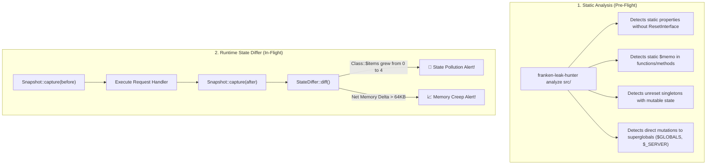

# 🧟 Franken-Leak-Hunter (PHP-Sentinel)

[](LICENSE)
[](https://www.php.net)
[](https://frankenphp.dev)
[](https://roadrunner.dev)
[](tests/)

> Production-grade **Memory Leak** and **Cross-Request State Pollution Detector** for **FrankenPHP**, **RoadRunner**, **Swoole**, and **Laravel Octane**.  
> Features a static AST analyzer to catch hazards before deployment and a zero-overhead runtime state differ that catches leaks between requests.

---

## ⚡ The Worker Mode Problem

In traditional **PHP-FPM**, PHP operates on a **"Share-Nothing"** architecture: every HTTP request starts with a pristine memory space and tears down all state at the end (`RSHUTDOWN`).

In **FrankenPHP**, **RoadRunner**, and **Laravel Octane**, PHP stays resident in memory to serve thousands of requests without process boot overhead:

```
[Request 1: User A] ──> [ PHP Worker Process (Stays in Memory) ] ──> [Request 2: User B]
                                   │
                                   ├── 🚨 Memory Creep: CartService::$items += 5 items
                                   ├── 🚨 State Contamination: $GLOBALS['user_id'] = 42
                                   └── 🚨 File Descriptor Leak: stream #14 unclosed
```

Without strict isolation:
1. 💥 **Memory Leaks**: Static collections, unbound memoization caches, and circular object references accumulate until the worker runs out of memory (`Allowed memory size exhausted`) or gets `SIGKILL`ed by the OS.
2. ☣️ **State Contamination**: User B arrives and receives User A's cached cart, permissions, or database transactions!

**Franken-Leak-Hunter** eliminates both problems.

---

## 🔍 How It Works

Franken-Leak-Hunter provides dual-layered protection:



---

## 🚀 Quickstart

### 1. Installation

```bash
composer require --dev anton-barinov/franken-leak-hunter
```

Or install standalone / clone directly:

```bash
git clone https://github.com/Anton-Barinov/Franken-Leak-Hunter.git
cd Franken-Leak-Hunter
./bin/franken-leak-hunter help
```

---

## 🖥️ CLI Commands

### 1. Static AST Scan (`analyze`)
Scan your codebase for state pollution and memory leak hazards:

```bash
./bin/franken-leak-hunter analyze src/
```

Output:
```
🔎 Franken-Leak-Hunter: Static State Pollution Scan
Target: src/

🚨 FOUND 3 HAZARDS in 42 files:
──────────────────────────────────────────────────────────────────
 CRITICAL  App\Service\CartService::$items in src/Service/CartService.php:12
  Static property App\Service\CartService::$items persists in worker memory across requests without a reset hook.
  > public static array $items = [];
  💡 Fix: Implement Symfony\Contracts\Service\ResetInterface or add a public reset() method to clear $items between requests.

 HIGH  calculateTax():static $taxRates in src/Utils/TaxCalculator.php:18
  Static local variable calculateTax():static $taxRates retains state between requests in worker mode.
  > static $taxRates = [];
  💡 Fix: Replace static local memoization with an injectable cache service (e.g., PSR-6/PSR-16) or WeakMap.
```

JSON output for CI/CD gates:
```bash
./bin/franken-leak-hunter analyze src/ --format=json
```

---

### 2. Multi-Request Simulation Profiler (`profile`)
Simulate N consecutive worker requests against a test script to analyze memory growth and catch creeping leaks:

```bash
./bin/franken-leak-hunter profile tests/Fixtures/worker_test.php --requests=20
```

Output:
```
🔬 Franken-Leak-Hunter: Multi-Request Simulation Profiler
Script: worker_test.php | Simulated Requests: 20
──────────────────────────────────────────────────────────────────
Completed 20 simulated worker requests.
Total Memory Delta: +48,128 bytes
Average Delta / Request: 2406.4 bytes

🚨 Static state pollution detected during execution:
  Request #1:
    • [App\Service\CartService::$items] Static collection accumulated +2 items (grew from 0 to 2)
  Request #2:
    • [App\Service\CartService::$items] Static collection accumulated +2 items (grew from 2 to 4)
```

---

## 🧩 Framework Integrations

### 1. Native FrankenPHP Worker Loop
Wrap your FrankenPHP worker script with automatic leak reporting:

```php
<?php
// worker.php
require __DIR__ . '/vendor/autoload.php';

use FrankenLeakHunter\Integration\FrankenPhpWorker;

FrankenPhpWorker::run(function () use ($app) {
    $request = Request::createFromGlobals();
    $response = $app->handle($request);
    $response->send();
    $app->terminate($request, $response);
}, [
    'autoDumpToStderr' => true,  // Prints colored diff if state pollution occurs
    'throwOnPollution' => false, // Set true in local/CI environments to fail tests
    'gcEvery'          => 50,    // Force gc_collect_cycles() every 50 requests
]);
```

---

### 2. PSR-15 Middleware (Slim, Mezzio, Symfony)
Add the middleware to monitor incoming requests:

```php
use FrankenLeakHunter\Integration\Psr15Middleware;

$app->add(new Psr15Middleware([
    'autoDumpToStderr' => true,
    'throwOnPollution' => false,
]));
```

Each HTTP response receives a diagnostic header:
```http
X-Franken-Leak-Hunter: status=clean; delta=+0 B
```

---

### 3. Fail Fast in Unit / E2E Tests (CI Testing)
Ensure your test suite verifies that services reset properly between simulated turns:

```php
use FrankenLeakHunter\Runtime\Hunter;
use FrankenLeakHunter\Runtime\StatePollutionException;

public function testWorkerTurnIsClean(): void
{
    Hunter::configure(['throwOnPollution' => true]);

    Hunter::watch(function () {
        $client = static::createClient();
        $client->request('GET', '/cart/add/42');
    }); // Throws StatePollutionException if static state leaked!
}
```

---

## 💡 How to Remediate Common Violations

### 1. Static Property Accumulation
❌ **Vulnerable:**
```php
class CartService {
    public static array $items = []; // Leaks between requests!
}
```
✅ **Fixed (Reset Hook):**
```php
use Symfony\Contracts\Service\ResetInterface;

class CartService implements ResetInterface {
    public static array $items = [];

    public function reset(): void {
        self::$items = [];
    }
}
```

### 2. Static Function Memoization
❌ **Vulnerable:**
```php
function getExchangeRate(string $currency): float {
    static $rates = []; // Retained forever in worker memory
    return $rates[$currency] ??= fetchRate($currency);
}
```
✅ **Fixed (Scoped Cache Service):**
```php
class CurrencyRateProvider {
    public function __construct(private \Psr\SimpleCache\CacheInterface $cache) {}

    public function getExchangeRate(string $currency): float {
        return $this->cache->get("rate_{$currency}", fn() => fetchRate($currency));
    }
}
```

---

## 🧪 Automated Test Suite

Run the built-in test suite (zero external dependencies required):

```bash
php tests/run_tests.php
```

Output:
```
🚀 Running Franken-Leak-Hunter Test Suite...

=== Static Analyzer Tests ===
  ✓ testDetectsLeakyCartServiceStaticProperty passed
  ✓ testCleanServiceWithResetMethodHasNoHazards passed
  ✓ testDetectsStaticVariableMemoization passed
  ✓ testDetectsGlobalMutation passed
  ✓ testDetectsLeakySingleton passed

=== Runtime State Differ Tests ===
  ✓ testDetectsLeakyCartServiceInRuntime passed
  ✓ testCleanServiceProducesCleanReport passed
  ✓ testDetectsGlobalVariablePollution passed
  ✓ testDetectsResourceLeak passed

=== Simulation & Profiler Tests ===
  ✓ testSimulateDetectsMonotonicCreep passed (5 iterations analyzed)

=== Framework Integration Tests ===
  ✓ testFrankenPhpWorkerRunExecutesHandler passed
  ✓ testPsr15MiddlewareAttachesDiagnosticsHeader passed
  ✓ testThrowOnPollutionOptionThrowsException passed

=== Console CLI Tests ===
  ✓ testAnalyzeCommandExitsWithHazardsOnFixtures passed
  ✓ testAnalyzeCommandJsonFormat passed
  ✓ testHelpCommandExitsZero passed

━━━━━━━━━━━━━━━━━━━━━━━━━━━━━━━━━━━━━━━━━━━━━━━━
🎉 ALL TESTS PASSED (16/16)!
```

---

## 🔗 Related Projects in the Ecosystem

- 🛡️ **[EOL-PHP-Armor](https://github.com/Anton-Barinov/EOL-PHP-Armor)** — Backport hub and runtime hotpatches for legacy PHP CVEs.
- 🔐 **[Composer-Audit-ZeroTrust](https://github.com/Anton-Barinov/Composer-Audit-ZeroTrust)** — Supply-chain security scanner and hidden webshell detector.
- 📦 **[PHP-to-Binary](https://github.com/Anton-Barinov/PHP-to-Binary)** — Compile PHP scripts into zero-dependency standalone binaries.
- 🤖 **[OpenCart-AI](https://github.com/Anton-Barinov/OpenCart-AI)** — E-Commerce MCP Bridge connecting AI agents to OpenCart stores.

---

## 📄 License

Franken-Leak-Hunter is open-source software licensed under the [MIT License](LICENSE).  
Maintained by **Anton Barinov** ([@Anton-Barinov](https://github.com/Anton-Barinov)).
